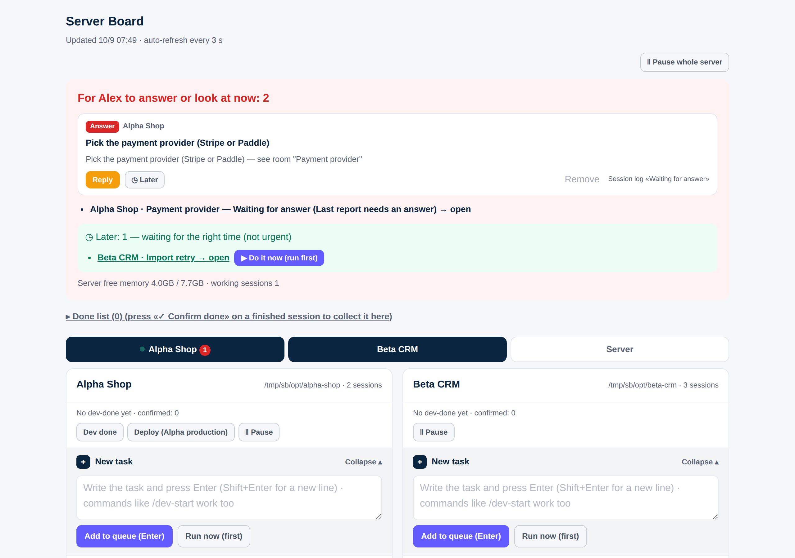

# 서버 상황판 (Server Board)

**내가 자리를 비워도 서버에서 Claude Code 가 계속 일하고, 모든 작업방의 진행·질문·보고를 웹 화면 한 장에서 봅니다.**

[English →](README.md) · [설치 안내](docs/INSTALL.ko.md) · [AI 설치 프롬프트](docs/AI-SETUP-PROMPT.ko.md) · [서비스 안내](docs/SERVICES.ko.md) · [서버 맞춤 안내서](docs/SERVER-GUIDE.ko.md) · [보안](SECURITY.md)

> 무료 공개판(MIT): 직접 설치해서 쓰는 기본 프로그램입니다.
> 설치·AI 연결·접근 권한·자동화 설정까지 맡기고 싶으면 → **[설치·구축 의뢰하기](https://care.wor-pro.com/inquiry.php?utm_source=github&utm_medium=docs&utm_campaign=server-board&lang=ko&plan=setup&src=readme-top)**

---

## 무엇을 해 주나

Claude Code 에 일을 맡기고 노트북을 닫아도, Claude 는 서버의 백그라운드 작업방(`claude --bg`)에서 계속 일합니다.
돌아와서 상황판을 열면:

| 맨 위 | **지금 내가 답하거나 볼 것**: 작업방이 남긴 질문·허락 요청·막힌 방. 초록이면 할 일 없음 |
|---|---|
| 솔루션(프로젝트)마다 | 작업방 목록: 일하는 중 / 답 기다림 / 끝남 / 멈춤, 마지막 보고, 확인할 링크 |
| 방을 열면 | 대화가 채팅처럼 보입니다. 브라우저에서 답하면 같은 대화로 이어서 일함 |
| 대기열 | 한 솔루션에 고치는 방은 하나만. 새 일은 줄 서 있다가 앞 일이 끝나면 저절로 시작 |
| 자동 이어하기 | 보고 없이 끊긴 방은 상황판이 «이어서 진행» 을 보냄(방마다 2번까지) |
| 정기 점검 | 정한 시각에 개발완료·배포·문의 가져오기·개발시작 중 체크한 것을 한 방에서. «배포» 를 체크하면 막는 것이 없을 때 바로 배포(체크를 끄면 안 함) |
| 터미널 메뉴 | 서버에 `ssh` 로 접속하면 요약 + 방 목록이 바로 뜸(`dev`) |

Node.js 파일 하나, HTML 파일 하나입니다. **설치할 라이브러리 없음 · DB 없음.** `127.0.0.1` 에만 열리고, 인터넷에는 열지 않고, 내 기기에서 Tailscale(내 기기끼리만 보이는 사설망) 또는 SSH 통로로 봅니다.



## 이런 분께

- 내 리눅스 서버(VPS·클라우드·사무실 서버)를 쓰는 1인 개발자·작은 팀
- 이미 **Claude Code** 를 쓰는데, 자는 동안에도 일하게 하고 휴대폰으로 질문에 답하고 싶은 분
- 한 서버에서 여러 고객 프로젝트를 돌리는 에이전시(프로젝트마다 카드 · 폴더를 섞지 않음)

## 빠른 시작 (약 10분)

필요한 것: `ssh` 로 들어갈 수 있는 리눅스 서버(root **불필요**) + Claude 구독 또는 Anthropic API 키

1. **SSH 열쇠로 서버에 접속**: [설치 안내 → 1단계](docs/INSTALL.ko.md#1단계--내-컴퓨터에서-ssh-열쇠-만들기) (맥·윈도우·리눅스, 붙여 넣는 명령 그대로)
2. **서버에서 명령 한 줄:**
   ```bash
   curl -fsSL https://raw.githubusercontent.com/ireneceo/server-board/main/install.sh | bash
   ```
   서버를 점검하고, 없는 것(Node·PM2·Claude Code)은 **물어본 뒤** 내 계정에 설치하고, 상황판을 켜고, 그 자리에서 Claude 로그인까지 안내합니다. 다시 실행해도 설정은 그대로입니다. (먼저 읽어 보려면: `curl -fsSLo install.sh https://raw.githubusercontent.com/ireneceo/server-board/main/install.sh && less install.sh && bash install.sh`)
3. **상황판 열기**: 설치기가 알려 준 통로(`ssh -L 8800:127.0.0.1:8800 사용자@서버주소` → http://localhost:8800). 맨 위 **처음 설정** 칸이 남은 일(대개 없음 또는 Claude 로그인)을 알려 줍니다. 그다음 **AI 로 설치 마무리 ▶** — Claude 가 상황판 질문 카드 하나로 프로젝트를 묻고 규칙·명령·정기 점검을 설정합니다.

터미널이 편하거나 손으로 하고 싶으면: [docs/AI-SETUP-PROMPT.ko.md](docs/AI-SETUP-PROMPT.ko.md) 를 `claude` 에 붙여 넣거나 [설치 안내](docs/INSTALL.ko.md) 를 따르세요.

## 무료와 맡기기

| | 내용 | |
|---|---|---|
| **무료 제공** | 이 저장소의 기본 프로그램. 직접 설치해서 계속 쓰면 됩니다 | 지금 보는 곳 |
| **유료 구축** | 고객 서버에 설치하고 AI(Claude Code) 연결, SSH 열쇠·접근 권한, 정기 점검·자동화 설정까지 구성. 첫날부터 바로 돌아가게 | [구축 의뢰 →](https://care.wor-pro.com/inquiry.php?utm_source=github&utm_medium=docs&utm_campaign=server-board&lang=ko&plan=setup&src=readme-table) |
| **유료 맞춤 작업** | 고객 서비스에 맞는 배포·백업·장애 대응 작업 추가(빌드·재시작·상태 확인, 배포 관문, 복원 연습) | [맞춤 작업 의뢰 →](https://care.wor-pro.com/inquiry.php?utm_source=github&utm_medium=docs&utm_campaign=server-board&lang=ko&plan=custom&src=readme-table) |
| **월 유지관리** | 서버와 자동화가 제대로 작동하는지 매달 점검하고 개선(Claude Code 업데이트 대응, 디스크·메모리, 백업, 실패한 실행) | [유지관리 문의 →](https://care.wor-pro.com/inquiry.php?utm_source=github&utm_medium=docs&utm_campaign=server-board&lang=ko&plan=maintenance&src=readme-table) |

포함 내용·준비할 것: **[docs/SERVICES.ko.md](docs/SERVICES.ko.md)**. 운영: [워프로랩(WOR-PRO Lab)](https://care.wor-pro.com/inquiry.php?utm_source=github&utm_medium=docs&utm_campaign=server-board&lang=ko&src=readme-brand)

## 어떻게 도나 (1분 설명)

```
휴대폰/노트북 ──Tailscale·SSH 통로──▶ 서버 127.0.0.1:8800  서버 상황판 (Node, PM2 «dev-board»)
                                  │  읽기: claude agents --json · 대화 기록 · projects.json
                                  │  시작: claude --bg (프로젝트 폴더마다 고치는 방 하나)
                                  ▼
                    프로젝트 폴더들(/opt/app1, /var/www/site …) — 각자 CLAUDE.md 규칙
```

- **상태는 작업방 스스로의 보고에서 읽습니다.** 모든 방은 상황판이 읽을 수 있는 첫 줄로 끝냅니다:
  `✅ 완료` · `⏸ 답 필요` · `❌ 막힘` · `🕓 나중에`. 설치할 때 이 규칙이 `~/.claude/CLAUDE.md` 에 들어갑니다.
- **질문은 맨 위로.** 방이 멈추기 전에 상황판에 질문을 올리고(`POST /api/asks`), 브라우저에서 답합니다.
- **내가 할 일은 따로.** 주인만 할 수 있는 단계(sudo·외부 서비스 설정·키 발급)는 방이 순서와 함께 따로 올리고(`POST /api/todos`) 나머지를 계속합니다. **했어요** 를 누르면 상황판이 이어서 할 일을 그 방(없으면 새 방)에 넘깁니다.
- **작업기록.** 프로젝트마다 짧은 기록(`.claude/session-state.md`)을 두고, 상황판은 «답 기다림»·«다음 확정 작업» 절을 보여 줍니다.
- **시험 역할로 열기.** «확인할 곳» 줄 끝에 `[as=owner ws=6]` 가 있으면 «owner 시험 계정으로 열기» 버튼이 붙습니다 — 그 역할 시험 계정으로 로그인된 채, 작업방이 남겨 둔 데이터와 함께 같은 화면이 열립니다. 프로젝트마다 개발서버 전용 라우트 하나를 더합니다 — `kit/DEV-LOGIN.md`.
- 전체 규칙(제목·첫 줄·API): [docs/HOW-IT-WORKS.md](docs/HOW-IT-WORKS.md)
- 서버·솔루션마다 다른 값과 «상황판에 이렇게 나오면 할 일»: [docs/SERVER-GUIDE.ko.md](docs/SERVER-GUIDE.ko.md) — 설치 뒤 서버 Claude 가 먼저 읽는 곳

## 안전

이 화면은 서버에서 AI 를 움직이는 버튼이라 SSH 로그인처럼 다뤄야 합니다.

- `127.0.0.1` 에만 열리고 요청마다 Host 를, 쓰기 요청마다 Origin 을 검사합니다. 명령은 셸 없이 실행합니다.
- nginx·공개 도메인에 **절대** 연결하지 마세요. Tailscale(사설망) 또는 SSH 통로로만.
- 작업방은 운영 배포·운영 데이터 쓰기·외부 발송을 스스로 하지 않습니다(주인 지시가 있을 때만).
- 혼자 쓰는 서버를 권합니다. [SECURITY.md](SECURITY.md)

## 언어

`board/config.json` 의 두 값:

- `"lang"` — 상황판 화면·안내서·설치 프롬프트: **한국어**(`"ko"`) 또는 **영어**(`"en"`).
- `"aiLang"` — 작업방(AI)이 보고·질문을 쓰는 언어. AI 가 쓰는 것이라 **어느 언어든** 됩니다: `"日本語"`, `"Español"`, `"Deutsch"`, `"Français"`, `"Tiếng Việt"`… 비우면 `lang` 과 같음. 일은 어느 쪽이든 자기 언어로 시켜도 됩니다.
- 둘 다 상황판 맨 위 **🌐 언어** 에서도 바꿀 수 있습니다(`config.json` 에 저장하고 상황판이 몇 초 만에 다시 켜짐 · 작업방은 계속 일함).

상황판은 보고 첫 줄 맨 앞의 상태 기호(✅ ⏸ ❌ 🕓)만 읽으므로 작업방이 어느 언어로 써도 똑같이 동작합니다.

## 어디서 돌아가나

| 서버 | 되나? | 이유 |
|---|---|---|
| VPS·클라우드 서버·내 리눅스 서버(Ubuntu·Debian…) | **됨** | 기본 경우 |
| 위와 같지만 일반 사용자만(root·sudo 없음) | **됨** | root 가 필요한 부분이 없습니다. Node·PM2·Claude Code 는 내 계정에 설치(nvm). «재부팅 때 PM2 자동 시작» 만 sudo — 없으면 crontab 의 `@reboot` 로 |
| 업체가 SSH 는 주고 root 는 안 주는 관리형 서버 | **대개 됨** | 프로그램을 계속 켜 둘 수 있고 SSH 통로(또는 Tailscale)가 되면 |
| 공유 웹호스팅(cPanel 류·PHP 사이트·SFTP/제한 SSH) | **대개 안 됨** | Node 가 없거나 낡음 · 오래 도는 프로그램을 끔 · SSH 통로 막힘 |
| 윈도우·맥을 서버로 | 안 됨 | 상황판이 리눅스 `/proc` 를 읽음. 접속하는 *컴퓨터* 는 무엇이든 됨 |

모르겠으면 서버에서 1분 점검(읽기만·root 불필요): `bash kit/check-host.sh --ko` (그 파일만 받아도 됨). 조건마다 ✔/✘ 로 알려 줍니다.

**공유 웹호스팅이면:** 사이트는 그대로 두고, 상황판과 Claude 는 작은 리눅스 서버(작업 서버)를 따로 둡니다. Claude 는 거기서 만들고 시험하고, `/배포` 가 SFTP·SSH·git 으로 호스팅에 올립니다. 이 구성은 대신 해 드립니다: [구축 의뢰](https://care.wor-pro.com/inquiry.php?utm_source=github&utm_medium=docs&utm_campaign=server-board&lang=ko&plan=setup&src=readme-hosting)

## 필요 조건

- 서버의 Claude Code 로그인: **Claude 구독**(Pro · Max · Team) 또는 **Anthropic API 키** — [설치 안내 4b단계](docs/INSTALL.ko.md#4b단계--ai-연결구독-또는-api-키). 연결 상태는 상황판에 보입니다.

- 리눅스(Ubuntu 22.04/24.04 확인) · Node 18+(20 확인) · PM2 5+ · python3 · git
- 백그라운드 방을 쓰는 Claude Code(`claude --bg`, `claude agents --json`) — **2.1.330** 로 확인. 상황판은 Claude Code 내부 형식 일부에 기대므로 스스로 점검합니다: Claude Code 버전이 바뀔 때마다 그 서버에서 형식을 다시 확인하고 자동 시험을 돌려, 바뀐 게 있으면 상황판 맨 위에 빨간 칸(휴대폰 알림 포함)으로 무엇이 깨졌는지 보여 줍니다. `bash kit/verify.sh` 에도 같은 결과가 나옵니다.
- 자동 시험: `cd board && node --test test/*.test.js` (추가 설치 없음 · 임시 복사본과 가짜 `claude` 로 돌아 실제 작업방은 건드리지 않음)
- 상황판 자체 메모리 약 100~200MB(작업방이 많을수록 늘어남)

## 참여

버그 신고·작은 수정은 Issues / Pull Request 로 환영합니다. 내 서버 설치 도움은 Issues 가 아니라 [설치 의뢰](https://care.wor-pro.com/inquiry.php?utm_source=github&utm_medium=docs&utm_campaign=server-board&lang=ko&plan=setup&src=readme-contrib)로 남겨 주세요.

## 사용 허락

MIT © WOR-PRO Lab: 누구나 쓰고 고치고 나눌 수 있고, 보증은 하지 않습니다. [LICENSE](LICENSE)
«Claude»·«Claude Code» 는 Anthropic 의 제품이며, 이 프로젝트는 Anthropic 과 관계없는 독립 프로젝트입니다.
