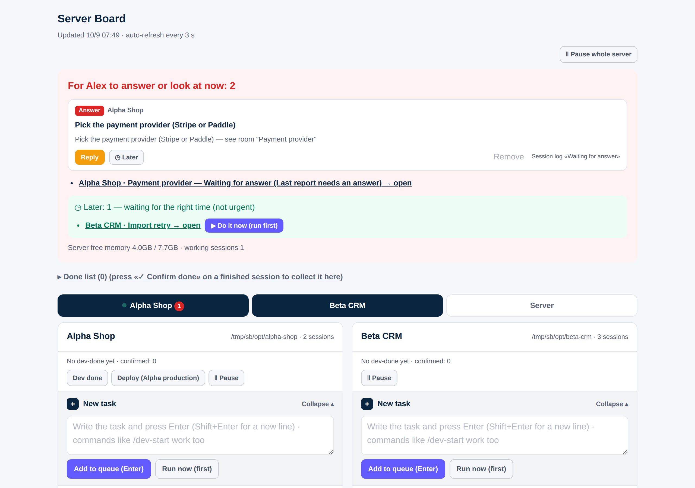

# Server Board

**Keep Claude Code working on your server while you're away, and see every agent, question and report on one private web page.**

[한국어 안내 →](README.ko.md) · [Install guide](docs/INSTALL.md) · [AI setup prompt](docs/AI-SETUP-PROMPT.md) · [Services](docs/SERVICES.md) · [Server guide](docs/SERVER-GUIDE.md) · [Security](SECURITY.md)

> Free and open source (MIT). You install and run it yourself.
> If you'd rather have it set up for you, on your server, with AI, access and automation configured, see **[Request setup →](https://care.wor-pro.com/inquiry.php?utm_source=github&utm_medium=docs&utm_campaign=server-board&lang=en&plan=setup&src=readme-top)**

---

## What it does

You give Claude Code a task and close the laptop. Claude keeps working on the server in a background session (`claude --bg`).
When you come back, open the board and you'll see:

| At the top | **What needs you now**: questions the agents left, permission prompts, blocked rooms. Green means nothing needs you. |
|---|---|
| Per project | Every agent ("room"): working / waiting for your answer / done / stopped, plus its last report and links to check |
| In a room | The conversation in chat form. Reply from the browser and the agent continues in the same session |
| Queue | One editing agent per project at a time. New tasks wait and start on their own when the previous one finishes |
| Auto-resume | If an agent is cut off without reporting, the board tells it to continue (max 2 times) |
| Scheduled checks | At times you set, tick what runs together in one room: dev-done, deploy, inquiries, dev-start. With "deploy" ticked the room deploys right away when nothing blocks it (untick to turn off) |
| Terminal menu | `ssh` into the server and a short summary + room list appears (`dev`) |

It's one Node.js file and one HTML file, with **no npm dependencies** and no database. It listens on `127.0.0.1` only, and you open it from your own devices through Tailscale (a private network of your devices) or an SSH tunnel, never the public internet.



## Who it's for

- Solo developers and small teams who run their own Linux server (VPS, cloud VM, office box)
- People already using **Claude Code** who want it to keep working while they sleep, and want to answer its questions from a phone
- Agencies running several client projects on one server (each project gets a card; agents never mix folders)

## Quick start (about 10 minutes)

You need a Linux server you can `ssh` into (root is **not** needed) and a Claude subscription or Anthropic API key.

1. **Connect to your server with an SSH key**: see [Install guide → Step 1](docs/INSTALL.md#step-1--make-an-ssh-key-on-your-computer) (Mac / Windows / Linux, copy-paste commands).
2. **One command on the server:**
   ```bash
   curl -fsSL https://raw.githubusercontent.com/ireneceo/server-board/main/install.sh | bash
   ```
   It checks the server, offers to install anything missing in your account (Node, PM2, Claude Code — it asks first), starts the board, and offers the Claude login right there. Run it again any time; it keeps your settings. (Prefer to read it first: `curl -fsSLo install.sh https://raw.githubusercontent.com/ireneceo/server-board/main/install.sh && less install.sh && bash install.sh`.)
3. **Open the board** through the tunnel it prints (`ssh -L 8800:127.0.0.1:8800 you@your-server` → http://localhost:8800). The **First setup** box shows what's left, usually nothing or the Claude login. Then press **Finish setup with AI ▶**: Claude asks about your projects in one question card on the board and sets up rules, commands and schedules.

Prefer a terminal, or doing it by hand? Paste [docs/AI-SETUP-PROMPT.md](docs/AI-SETUP-PROMPT.md) into `claude`, or follow the [Install guide](docs/INSTALL.md).

## Free vs. done-for-you

| | What you get | |
|---|---|---|
| **Free** | The program in this repository. Install it yourself and use it as long as you like | You're here |
| **Paid setup** | We install it on *your* server and connect Claude Code (AI), SSH keys and access permissions, schedules and automation, so it works from day one | [Request setup →](https://care.wor-pro.com/inquiry.php?utm_source=github&utm_medium=docs&utm_campaign=server-board&lang=en&plan=setup&src=readme-table) |
| **Paid custom work** | Deploy, backup and incident-response routines built for *your* service (build/restart/health checks, deploy gates, restore drills) | [Request custom work →](https://care.wor-pro.com/inquiry.php?utm_source=github&utm_medium=docs&utm_campaign=server-board&lang=en&plan=custom&src=readme-table) |
| **Monthly maintenance** | We check every month that the server and automations are working (Claude Code updates, disk/memory, backups, failed runs) and improve them | [Request maintenance →](https://care.wor-pro.com/inquiry.php?utm_source=github&utm_medium=docs&utm_campaign=server-board&lang=en&plan=maintenance&src=readme-table) |

Details, what's included and what to prepare: **[docs/SERVICES.md](docs/SERVICES.md)**. Run by [WOR-PRO Lab](https://care.wor-pro.com/inquiry.php?utm_source=github&utm_medium=docs&utm_campaign=server-board&lang=en&src=readme-brand).

## How it works (one minute)

```
your phone / laptop ──Tailscale · SSH tunnel──▶ server 127.0.0.1:8800  Server Board (Node, PM2 "dev-board")
                                         │  reads: claude agents --json · session transcripts · projects.json
                                         │  starts: claude --bg  (one editing room per project folder)
                                         ▼
                           project folders (/opt/app1, /var/www/site, …), each with its own CLAUDE.md rules
```

- **Status comes from the agents' own reports.** Every agent ends with a first line the board can read:
  `✅ Done` · `⏸ Needs answer` · `❌ Blocked` · `🕓 Later`. The installer adds this rule to `~/.claude/CLAUDE.md` for you.
- **Questions go to the top.** Agents post a question to the board (`POST /api/asks`) before they stop, and you answer from the browser.
- **Your own to-dos, split off.** When only you can do a step (sudo, a console setting, a key), the agent posts it (`POST /api/todos`) with steps and keeps working. Press **Done** and the board hands the follow-up back to that agent (or a new one).
- **Project notes.** Each project keeps a short log (`.claude/session-state.md`); the board shows its "Waiting for answer" and "Next up" sections.
- **Open as the test role.** A "Where to check" line ending in `[as=owner ws=6]` gets an "Open as test owner" button: the page opens logged in as that role's test account, with the data the agent left for you. Each project adds one dev-only route — see `kit/DEV-LOGIN.md`.
- Full contract (headings, first lines, API): [docs/HOW-IT-WORKS.md](docs/HOW-IT-WORKS.md).
- What differs per server/project and "the board shows X, do Y": [docs/SERVER-GUIDE.md](docs/SERVER-GUIDE.md), the first thing the server's Claude reads after install.

## Safety

This page can start AI agents on your server, so treat it like an SSH login:

- It binds to `127.0.0.1` only, checks `Host` on every request and `Origin` on every write. Commands run without a shell.
- **Never** put it behind nginx or a public domain. Use Tailscale (private network) or the SSH tunnel.
- Agents never deploy to production, write production data, or send email on their own; the shared rules require your explicit instruction.
- Recommended for single-user servers. Read [SECURITY.md](SECURITY.md).

## Language

Two settings in `board/config.json`:

- `"lang"` — the board screen, docs and setup prompt: **English** (`"en"`) or **Korean** (`"ko"`).
- `"aiLang"` — the language the AI sessions write their reports and questions in. **Any language** works, because the AI writes it: `"日本語"`, `"Español"`, `"Deutsch"`, `"Français"`, `"Português"`, `"Tiếng Việt"`… Empty = same as `lang`. You can also give tasks in your own language either way.
- Both can also be changed on the board itself: **🌐 Language** at the top (saves `config.json` and restarts the board in a few seconds; sessions keep working).

The board reads only the status emoji at the start of a report (✅ ⏸ ❌ 🕓), so it works whatever language the sessions write in.

## Where it runs

| Server | Works? | Why |
|---|---|---|
| VPS / cloud VM / your own Linux box (Ubuntu, Debian…) | **Yes** | The normal case |
| Same, but you only get a normal user (no root, no sudo) | **Yes** | Nothing needs root. Node, PM2 and Claude Code install in your account (nvm). Only "start PM2 at boot" needs sudo; without it use `@reboot` in your crontab |
| Managed server where the provider gives you SSH but not root | **Usually** | OK if long-running processes are allowed and SSH port forwarding (or Tailscale) works |
| Shared web hosting (cPanel-style, PHP sites, SFTP/jailed SSH) | **Usually no** | No Node or an old one, long-running processes are killed, SSH tunnels blocked |
| Windows / macOS as the server | No | The board reads Linux `/proc`; your *computer* can be anything |

Not sure? Run the one-minute check on the server, read-only, no root: `bash kit/check-host.sh` (or download just that file). It prints ✔/✘ per requirement.

**On shared web hosting:** keep the site where it is, and put the board and Claude on a small separate Linux server (a work server). Claude works and tests there, and `/deploy` pushes to your hosting over SFTP/SSH/git. We can set this up: [request setup](https://care.wor-pro.com/inquiry.php?utm_source=github&utm_medium=docs&utm_campaign=server-board&lang=en&plan=setup&src=readme-hosting).

## Requirements and tested versions

- A Claude Code login on the server: a **Claude subscription** (Pro / Max / Team) or an **Anthropic API key** — see [Install · step 4b](docs/INSTALL.md#step-4b--connect-claude-subscription-or-api-key). The board shows whether it is connected.

- Linux (Ubuntu 22.04/24.04 tested), Node 18+ (20 tested), PM2 5+, python3, git
- Claude Code with background sessions (`claude --bg`, `claude agents --json`) — tested with **2.1.314**. The board relies on some internal formats of Claude Code, so it checks them itself: whenever the Claude Code version changes it re-checks those formats on your server and runs its self-tests; if anything moved, a red box appears at the top of the board (with a phone alert) naming what broke. `bash kit/verify.sh` shows the same result.
- Self-tests: `cd board && node --test test/*.test.js` (no extra packages; uses a throwaway copy and a fake `claude`, never your real sessions).
- Memory: about 100–200 MB for the board itself (grows with the number of sessions).

## Contributing

Bug reports and small fixes are welcome via Issues / Pull Requests. For installation help on your own server, please use the [setup request](https://care.wor-pro.com/inquiry.php?utm_source=github&utm_medium=docs&utm_campaign=server-board&lang=en&plan=setup&src=readme-contrib) instead of Issues. Issues are for bugs in the code.

## License

MIT © WOR-PRO Lab. Free to use, change and share. No warranty. See [LICENSE](LICENSE).
"Claude" and "Claude Code" are products of Anthropic. This project is independent and not affiliated with Anthropic.
